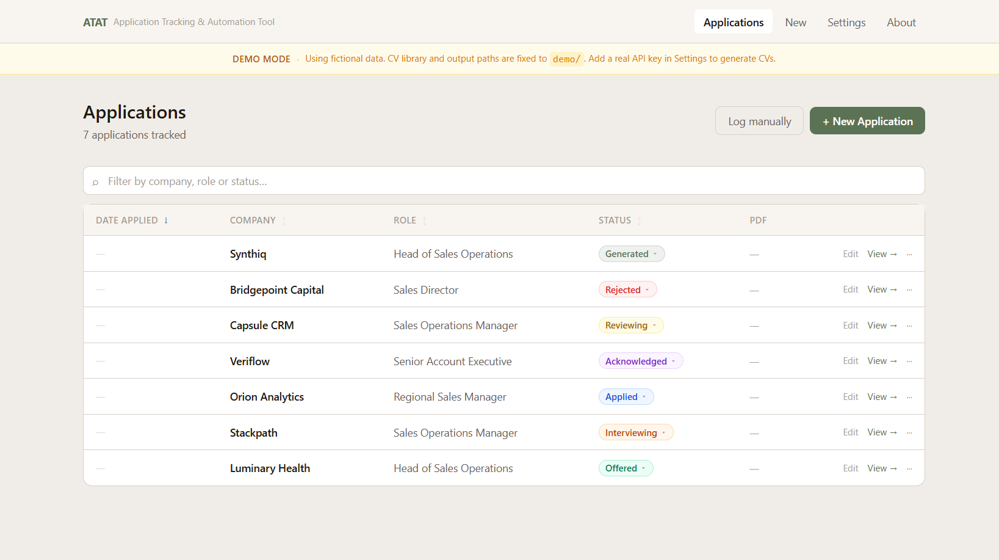
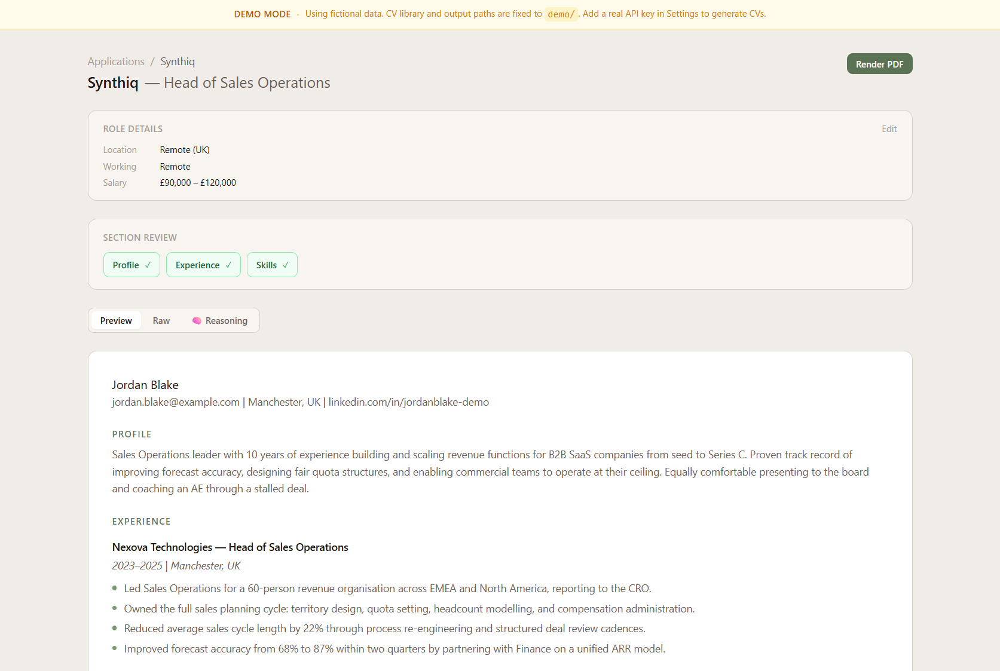
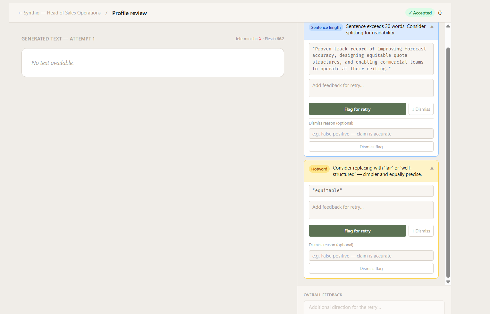

# ATAT — Application Tracking and Automation Tool

A personal applicant tracking system with an LLM-powered CV generation pipeline.
Paste a job description, get a tailored CV out. Built for people who treat their
job search the way they'd treat any other systems problem.

## Screenshots

<table>
  <tr>
    <td align="center">
      
      <sub><b>Application tracker</b> — sortable list with status, salary and role details</sub>
    </td>
    <td align="center">
      
      <sub><b>Application detail</b> — CV preview, role metadata and section review</sub>
    </td>
    <td align="center">
      
      <sub><b>Human-in-the-loop review</b> — judge flags with dismiss and action workflow</sub>
    </td>
  </tr>
</table>

## Architecture

```
cv-library/     ← separate private repo — experience data, personas, skills
atat/           ← this repo
  api/          ← FastAPI backend — applications, generation, review, render
  web/          ← Next.js frontend — tracker UI, CV preview, section review
  pipeline/     ← LLM tailorer, PDF renderer, judge pipeline
  db/           ← SQLite schema and migrations
  mcp_server/   ← MCP server — lets an agent drive ATAT directly (see below)
  demo/         ← fictional seed data and cv-library for demo mode
  prompts/      ← LLM system prompts
  output/       ← generated CVs (gitignored)
```

## Setup

### Prerequisites
- Python 3.11+
- Node.js 18+
- A clone of your cv-library repo
- An Anthropic or OpenAI API key
- [Typst](https://typst.app/) for PDF rendering
- Poppins font TTFs in `fonts/` (see below)

### Installation

```bash
git clone https://github.com/yourusername/atat.git
git clone https://github.com/yourusername/cv-library.git  # skip for demo mode

cd atat
python -m venv .venv
source .venv/bin/activate  # or .venv\Scripts\activate on Windows
pip install -r requirements.txt

cd web && npm install && cd ..

cp .env.example .env
# Edit .env — set CV_LIBRARY_PATH and your API key
```

### Fonts

Download the [Poppins](https://fonts.google.com/specimen/Poppins) family and place
the TTF files into `fonts/`. The PDF renderer expects them at that path.

### Running

```bash
# Development
./dev.sh          # API on :8001, web on :3001, MCP server on :8765

# Production on this machine
./start.sh        # builds, then API on :8000, web on :18080, MCP server on :8765
```

On a phone or another computer, don't run these — use [Deploying](#deploying-to-a-home-server).

## Deploying to a home server

ATAT is built to run always-on on a home server, one **instance per person**. An instance
is its own stack — database, CV library, generated CVs, personal prompts, Gmail connection,
password and port — so two people never share data. The code and shared prompts are the same.

```
instances/kerri/            ← ATAT_HOME inside the containers (/data)
  .env                      ← API key, ATAT_PASSWORD, settings   (private, git-ignored)
  compose.env               ← port, CV library location          (private, git-ignored)
  data/atat.db, data/gmail/ ← created on first run
  output/, logs/, prompts/  ← her CVs, failure dumps, personal_additions.md
```

### Set up an instance

1. Copy the template and fill it in:
   ```bash
   cp -r instances/example instances/kerri
   mv instances/kerri/.env.example instances/kerri/.env
   mv instances/kerri/compose.env.example instances/kerri/compose.env
   ```
   In `.env`: set `ANTHROPIC_API_KEY` and a long `ATAT_PASSWORD`. In `compose.env`: give
   the instance its own `WEB_PORT`, point `CV_LIBRARY_DIR` at *her* CV library, and set
   `ATAT_UID`/`ATAT_GID` to the owner of the folder (`id -u`, `id -g`).
2. Put the Poppins `.ttf` files in `fonts/` (shared by every instance).
3. Start it:
   ```bash
   docker compose --env-file instances/kerri/compose.env -p atat-kerri up -d --build
   ```
4. Open `http://localhost:<WEB_PORT>` on the server and sign in.

Start from an **empty** instance for a new person. Don't copy someone else's
`personal_additions.md` — it is injected into every CV prompt — or their database.
(A database copied between machines also carries absolute output paths, so it only works if
the new instance uses the same mount path.)

### Exposing it safely

Only the web container publishes a port, and it listens on `127.0.0.1` by default. The API
and MCP server are never published to the network. To reach it from a phone:

- **Tailscale** (simplest): `tailscale serve --bg --https=443 http://127.0.0.1:<WEB_PORT>`,
  then open the machine's tailnet name on the phone and "Add to Home Screen".
- Or a reverse proxy with HTTPS (Caddy, Traefik) behind Cloudflare Access / a VPN.

Always keep `ATAT_PASSWORD` set. It is one shared password per instance (a signed,
30-day cookie; failed logins are rate-limited) — a second lock behind the private network,
not a replacement for it. Don't use `WEB_BIND=0.0.0.0` without it.

For a non-technical user set `ATAT_LOCK_ADVANCED=true` in the instance `.env`: the AI
provider, keys, models, file paths and the shared prompts become read-only in the app, and
the Advanced settings block is hidden. Change them in the `.env` and restart:
`docker compose --env-file instances/kerri/compose.env -p atat-kerri restart api`.

### Gmail

Connecting Gmail is a one-time step that needs a browser. Put the Google OAuth client file
(`client_secret.json`, type "Desktop app") in the instance's `data/gmail/` folder (a copy in
`data/` is found too; the command lists every place it looked if it finds none).

On a laptop with this repo and that instance's folder as `ATAT_HOME`, then copy the result across:

```bash
ATAT_HOME=$PWD/instances/kerri python -m pipeline.inbox.auth   # writes instances/kerri/data/gmail/token.json
```

On a **headless server**, pick a fixed port so it can be tunnelled, instead of reading a random
one out of the URL:

```bash
# on the server (in the container, listen on 0.0.0.0 and publish the port)
docker compose --env-file instances/kerri/compose.env -p atat-kerri run --rm -p 8765:8765 api \
  python -m pipeline.inbox.auth --no-browser --port 8765 --host 0.0.0.0
# on your laptop, in another terminal
ssh -L 8765:localhost:8765 <server>
```

Open the URL it prints in the laptop's browser. Google redirects back to
`http://localhost:8765/`, which the tunnel carries to the server. The CV email in `meta/meta.md`
should be the connected account (or an alias of it): replies go to the CV address, and the
Inbox page warns when it differs.

Set `GMAIL_ENABLED=true` and `INBOX_CLASSIFIER=api` in the instance `.env` (the app itself
sorts the mail; `agent` mode needs an MCP client). After editing an instance `.env` by hand,
run `restart api`: the app reads that file itself, so `up -d` sees no change and won't do it.

### Shaping the CV (per instance)

Set in the instance `.env`:

| Setting | Default | |
|---|---|---|
| `PROFILE_PARAGRAPHS`, `PROFILE_WORDS_MIN`, `PROFILE_WORDS_MAX` | 2, 80, 120 | profile shape; written into the prompt and checked by the judge |
| `EARLIER_EXPERIENCE_HEADING` | `Earlier experience` | heading over the compressed earlier roles |
| `HEADING_RULE` | `full` | rule beside PDF section headings: `full`, `short` or `none` |
| `HEADING_TRACKING` | `0.5` | heading letter-spacing in points; above ~0.6 ATS parsers read "P R O F I L E" |
| `LINK_UNDERLINE` | `true` | underline links in the PDF |
| `AUTO_JUDGE` | `true` | run the judges as soon as a CV is generated |

The CV header (name, email, phone, location, LinkedIn, website) is built from the library's
`meta/meta.md`, not by the model: write `**Email:** ...`, `**Location:** ...` and so on. Name,
email and location are required; website is optional (a line saying `DO NOT INCLUDE` keeps a
field off the CV). Facts you want on record but never on a CV go under a `## Private` heading
(or between `<!-- private -->` and `<!-- /private -->`) in an experience file; they are removed
before anything is sent to a model or shown by the MCP library tools.

### Day to day

```bash
docker compose --env-file instances/kerri/compose.env -p atat-kerri logs -f api
docker compose --env-file instances/kerri/compose.env -p atat-kerri up -d --build   # update
```

Back up each instance directory (it is the whole instance) and her CV library. Keep the
instance on a local disk, not a network share or cloud-synced folder — SQLite's WAL files
don't survive those. Add `--profile mcp` to also run the MCP server (localhost only).

## Demo Mode

ATAT ships with a fictional dataset for portfolio and demo use. To activate:

1. Set `DEMO_MODE=true` in `.env`
2. Run the seed script: `python -m demo.seed`
3. Restart both servers

The app will use `demo/atat.db` and `demo/cv-library/` instead of your real data.
A banner is shown in the UI to make the demo context clear. Path settings are locked
while demo mode is active.

## CV Library

ATAT expects a cv-library at the path set in `CV_LIBRARY_PATH`. The library follows
this structure:

```
cv-library/
  experience/     ← one .md file per role
  personas/       ← persona definitions used for LLM classification
  skills/
    skills.md
  meta/
    meta.md       ← name, contact info
```

See `demo/cv-library/` for a complete worked example.

## MCP Server

`mcp_server/` exposes ATAT to an MCP client (Claude Desktop, Claude Code, Cowork)
as a set of tools, so an agent can browse your application history, generate and
review CVs, and mine past feedback for patterns — without going through the web UI.
It imports `db/` and `pipeline/` directly (same SQLite file, same generation code
as the FastAPI app), rather than proxying HTTP calls.

```bash
pip install -r requirements.txt   # includes the `mcp` package
cp .mcp.json.example .mcp.json    # then add it to your MCP client's config
```

### Generation is asynchronous, with an optional review step

Every generative tool — `analyse_job`, `generate_cv`, `run_coverage`,
`run_judges`, `regenerate_section`, `generate_cover_letter`, `generate_answers`,
`submit_job` — queues a background job and returns a `job_id` at once, rather
than holding the call open for the minutes a model call can take. The agent
carries on and reads the result later with `get_job` (or `wait_for_job`, a
bounded wait for when there's nothing else to do).

Pass `draft=True` and nothing is sent to a model: the request is saved as a
draft with its inputs and a preview of the exact prompt (unchanged cv-library
content elided). Review and edit it on the web UI's **Drafts** page, or through
the agent with `update_draft` — then `submit_draft`. Jobs live in the
`generation_jobs` table and run in whichever process accepted them (MCP server
or API); a job cut off by a restart is marked failed, never silently re-run.

### Tool groups

- **Applications** — `list_applications`, `get_application`, `get_cv_markdown`,
  `get_reasoning`, `get_events`, `get_dates`, `log_date`, `add_note`,
  `update_application`, `update_cv_markdown`, `render_cv`
- **Generation pipeline** — `list_sections`, `get_section_chain`, `get_report`,
  `run_judges`, `accept_report`, `regenerate_section`
- **Cover letters** — `get_cover_letter`, `generate_cover_letter`,
  `update_cover_letter`, `render_cover_letter`
- **Application questions** — `list_questions`, `add_question`,
  `delete_question`, `generate_answers`, `update_answer`, `submit_answer_feedback`
- **Intake** — `scrape_job_url`, `analyse_job`, `get_jd_spec`, `update_jd_spec`,
  `generate_cv`, `run_coverage`, `get_coverage`, `find_by_source_url`,
  `get_recent_notes`, `submit_job` (legacy single-phase)
- **Jobs** — `get_job`, `list_jobs`, `update_draft`, `submit_draft`,
  `cancel_job`, `retry_job`, `wait_for_job`
- **Submission** — `get_application_bundle`, `record_submission`
- **Insights** — `get_prompt_signals`, `get_exclusion_patterns`,
  `get_success_stats`, `search_applications`, `get_flag_history`,
  `get_reference_cvs`
- **cv-library** — `list_experience_entries`, `get_experience_entry`,
  `list_personas`, `get_persona`, `get_skills`, `get_meta`, `search_library`
- **Prompt tuning** — `get_personal_additions`, `add_personal_rule`,
  `update_personal_additions`
- **Meta** — `get_guide`

`render_cv` matters after any `accept_report`/`regenerate_section` call — those
update `cv.md` but don't auto-render a new PDF (same as the web UI).
`list_sections`' `latest_report` field carries the `report_id` every
generation-pipeline tool needs — `accepted_report_id` is NULL until
something's actually been accepted, so it's the only way to find a report id
right after `generate_cv`. The cv-library tools expose the *raw, untailored*
source material (experience entries, personas, skills, contact info) —
distinct from `get_cv_markdown` (one application's already-tailored output)
and `get_reference_cvs` (full CV content from applications that actually got
*screened favorably* — interviewing/case_study/offered by default, ranked by
outcome strength then recency, not merely applied — real working examples,
not raw source material).
`add_personal_rule` is the fix for a *recurring* generation mistake — it's
appended to `personal_additions.md`, loaded into every future generation's
and retry's system prompt, so a correction only has to be made once rather than
re-typed into `generation_notes` on every CV. `get_guide` (and the
equivalent `atat://guide` resource, for clients that support MCP resources)
is a fetchable workflow-sequencing and valid-value glossary that doesn't
belong to any single tool's docstring — call it first in a new session.

### Working a Todoist queue

ATAT's MCP server intentionally has no Todoist or browser tools of its own —
that orchestration lives in the agent, which can hold multiple MCP servers at
once. A typical setup: a Todoist MCP server, ATAT's MCP server, and a browser
tool (e.g. `claude-in-chrome`), all available to the same session. The agent then:

1. Pulls the next job ad from a Todoist project, respecting your priority order.
2. Calls `scrape_job_url`; if the page won't yield clean text (JS-rendered board,
   login wall), falls back to the browser tool to extract the JD manually.
3. Checks `get_prompt_signals` / `get_success_stats` / `search_applications` for
   relevant history before generating.
4. Calls `analyse_job`, shows you the spec's gaps, then drafts `generate_cv` for
   your review and submits it once you've approved it. While it runs, the agent
   moves on to the next task; it picks the result up with `get_job`, then
   inspects flags via `get_report` — accepts clean
   sections automatically, or leaves the Todoist task open with a comment when
   something needs a human call.
5. Generates the cover letter and question answers, then calls
   `get_application_bundle` and hands it to the browser tool to fill out the
   actual application form.
6. Calls `record_submission`, then completes the Todoist task.

Whether the agent submits fully autonomously or pauses for review before the
final click is a matter of how you operate the agent (Claude Desktop vs. Cowork,
system prompt, etc.) — not something the ATAT tools enforce.

## Roadmap

- [x] LLM-powered CV generation with extended thinking
- [x] Typst → PDF rendering with ATS metadata
- [x] Web-based application tracker
- [x] Tiered judge pipeline (deterministic → LLM → human-in-the-loop)
- [x] Section versioning with generational lineage
- [x] Demo mode with fictional seed data
- [ ] Cover letter generator
- [ ] Application question support
- [ ] Interview prep
- [x] MCP server for agent-driven generation, review, and pattern mining
